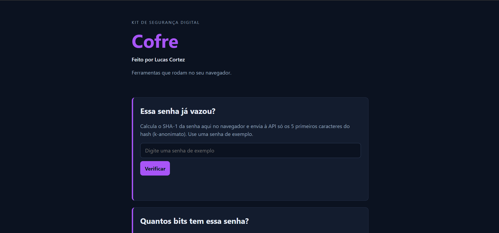

# Cofre — Kit de Segurança Digital

Ferramentas de segurança digital que rodam 100% no navegador, sem enviar dados sensíveis para servidores externos.

## Ferramentas disponíveis
1. **Verificador de vazamentos:** consulta o prefixo SHA-1 (k-anonimato) para saber se uma senha já apareceu em vazamentos.
2. **Calculadora de bits:** calcula a entropia da senha com base no tamanho do alfabeto utilizado.
3. **Verificador de link suspeito:** detecta sinais de phishing (ausência de HTTPS, IP direto, @, punycode e excesso de subdomínios).

## Autor
Desenvolvido por **Lucas Cortez** na disciplina de Introdução à Ciência da Computação (2026/2).
